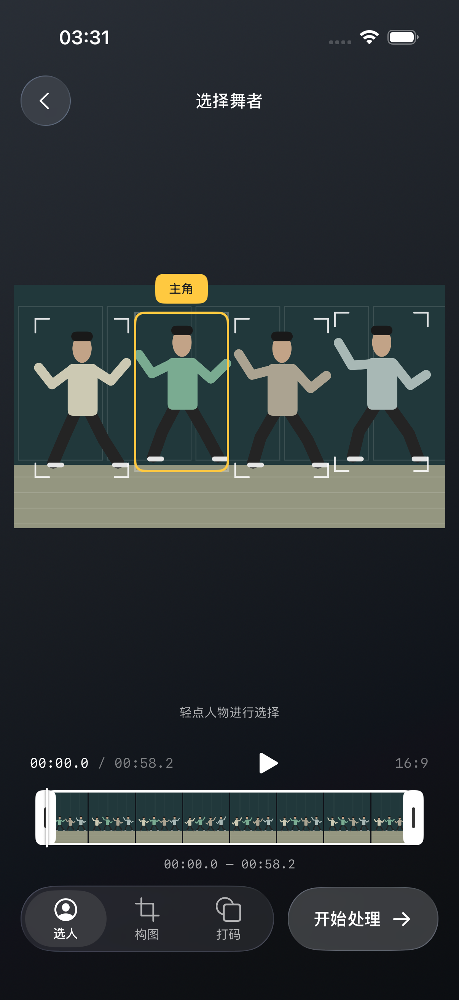
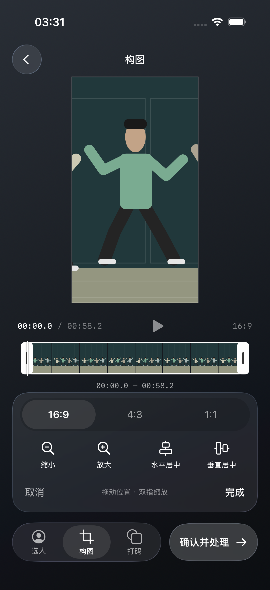
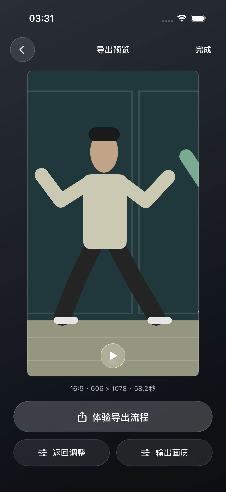
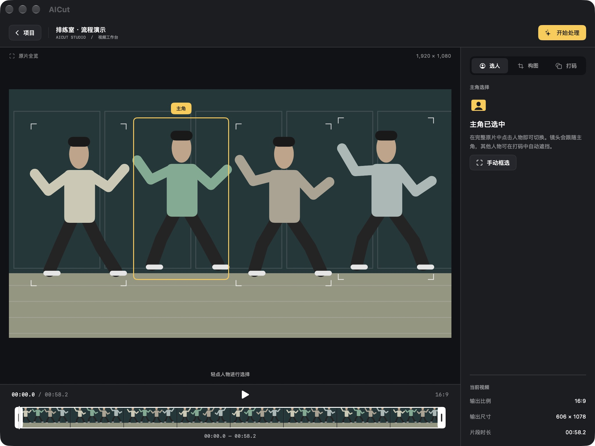

<p align="center">
  
</p>

# 直拍鸭 · Fancam Duck

将多人舞蹈视频转换为跟随主角的成片。使用 SwiftUI、Core ML 和 AVFoundation 在本地完成选人、身份跟踪、平滑运镜、自动裁剪及非主角遮挡，支持 iPhone、iPhone Duo、大屏工作台和 Mac Catalyst。

[快速开始](#开发与运行) · [界面预览](#界面预览) · [测试与验证](#测试与验证) · [参与贡献](#参与贡献) · [开源协议](#开源协议)

视频分析与导出在设备端完成，内置模型无需运行时下载。当前为开发中的原生应用，真机性能与复杂遮挡场景的验证边界见下方说明。

## 界面预览

以下为早期演示模式的模拟人物截图，不代表真实视频跟踪效果；当前工作台交互见[设计稿](docs/design/analysis-reuse/prototype.html)，功能流程以本页下文为准。

<table>
  <tr>
    <th>选择主角</th>
    <th>调整构图</th>
    <th>成片预览</th>
  </tr>
  <tr>
    <td></td>
    <td></td>
    <td></td>
  </tr>
</table>

Mac Catalyst 工作台：



## 功能与流程

1. **导入视频**：从相册导入；桌面端支持文件导入。创建本地项目并自动保存编辑配置。
2. **选人与选段**：显示完整原片，在画面点选主角，通过时间轴两端截取。首次阶段不显示构图或打码设置。
3. **分析所选片段**：分析主角与人群，持久化保存结果；支持暂停、继续。未识别到主角或身份不确定时停在问题帧，由用户指定并确认后继续。
4. **即时设置**：分析完成后在同一工作台调整构图与打码，无取消／完成步骤。画幅、拖动、缩放与单轴居中共用预览／导出变换；打码默认关闭，手动开启后遮挡其他人物；毛玻璃、马赛克、内置 Logo 图片样式互斥。切换打码保持当前构图。
5. **生成视频**：按当前设置编码，复用已保存的人群观测和主角轨迹；底部显示唯一进度，可取消回到设置。
6. **预览与导出**：在工作台播放已生成视频，保留原音；手机保存到相册，Mac 保存到文件，保存时不再编码。
7. **返回修改**：保留分析结果，修改设置后重新生成；新文件成功前保留旧成片。项目重开同样复用通过源文件和版本校验的分析结果。

手机编辑页保持不滚动；大屏使用视频与设置分区布局，Mac 使用桌面工作台。界面采用玻璃材质控件和 SF Symbols。构图／打码 Tab 与生成按钮位于底部，默认选中构图，重复点击不取消选中；设置面板显示在其上方。运镜默认柔和，不单独占用底部工具入口。

> 当前产品中的画幅标签按高宽顺序定义：`16:9` 对应竖向 9×16，`4:3` 对应竖向 3×4，`1:1` 对应正方形。几何计算使用宽／高比，详见 `OutputAspectRatio`。输出分辨率依据源视频和当前画幅生成，按小到大排列。

## 开发与运行

工程与 Scheme 名称为 `Fancam Duck`，Swift 模块为 `FancamDuck`。中文应用名为「直拍鸭」，英文应用名为「Fancam Duck」。旧安装的签名标识保持兼容，历史项目目录在首次打开时迁移。

- 部署基线：iOS 18；Mac 版本使用 Mac Catalyst。
- 支持 Xcode 27.0 的自适应布局构建；原生 Duo 分区布局需包含相应 API 的 SDK，并显式启用编译标志，见 [工具链说明](docs/ai/validation.md#工具链)。历史验证使用过 Xcode 27.1。
- 模型已包含在 `Fancam Duck/Models`，由 Xcode 编译，无需运行时下载；正常构建不需要 Python 环境。

打开工程：

```sh
git clone https://github.com/WX-DongXing/Fancam-Duck.git
cd Fancam-Duck
open 'Fancam Duck.xcodeproj'
```

选择 `Fancam Duck` scheme 和可用的 iPhone 模拟器运行。Mac 选择 Mac Catalyst 目标；真机运行需在 Signing & Capabilities 配置自己的开发团队。

启动参数 `--demo-editor` 可直接进入演示编辑流程。演示使用程序绘制素材，不生成真实视频，也不请求相册保存权限。

模拟器构建：

```sh
xcodebuild -project 'Fancam Duck.xcodeproj' -scheme 'Fancam Duck' \
  -destination 'platform=iOS Simulator,name=iPhone 17 Pro' \
  -derivedDataPath /tmp/fancamduck-build CODE_SIGNING_ALLOWED=NO build
```

Mac Catalyst 构建：

```sh
xcodebuild -project 'Fancam Duck.xcodeproj' -scheme 'Fancam Duck' \
  -destination 'platform=macOS,variant=Mac Catalyst' \
  -derivedDataPath /tmp/fancamduck-mac-build CODE_SIGNING_ALLOWED=NO build
```

## 识别、跟踪与渲染

```text
视频解码 → YOLO26s-pose 人物与姿态检测 → OSNet 外观特征
         → TrackTrack 身份关联 → 遮挡恢复／必要时人工确认
         → 平滑裁剪轨迹 → 可选非主角遮挡 → 预览／MP4 导出
```

- **YOLO26s-pose**：FP16 Core ML，640×640 输入，原始姿态输出，应用侧执行 NMS。
- **OSNet x0.25 MSMT17**：128×256 人物裁块，输出 512 维归一化 ReID 特征。
- **TrackTrack**：基于固定版本移植的 Swift 实现，包含 TPA／TAI 关联和 Kalman 状态。当前相机运动补偿为恒等变换，主要适配固定机位。
- **打码**：复用现有人物检测、姿态和身份关联能力，不使用 Apple Vision 检测；对遮挡轨迹进行时序稳定处理。
- **裁剪与导出**：AVFoundation 顺序取帧，使用稳定轨迹生成裁剪变换；音频截取相同时间范围，输出 MP4。

模型来源、权重哈希、工具版本及输入输出约定见 [模型清单](<Fancam Duck/Models/manifest.json>) 和 [模型来源说明](<Fancam Duck/Models/README.txt>)。重新转换模型的依赖和脚本位于 [tools/model_export](tools/model_export)。转换可能下载权重，属于开发步骤。

## 代码结构

| 目录 | 职责 |
| --- | --- |
| `Fancam Duck/App` | 应用入口、状态流转、异步任务与生命周期 |
| `Fancam Duck/Design` | 玻璃材质、主题与自适应布局 |
| `Fancam Duck/Domain` | 项目、时间范围、坐标和输出配置 |
| `Fancam Duck/Features` | 项目列表、选人、构图、时间轴与导出界面 |
| `Fancam Duck/Tracking` | 检测、身份关联、遮挡恢复与运镜 |
| `Fancam Duck/Redaction` | 非主角遮挡计划、跟踪与合成 |
| `Fancam Duck/Services` | 媒体读取、存储、模型服务、编码和保存 |
| `FancamDuckTests` / `FancamDuckUITests` | 单元、媒体集成和界面回归测试 |
| `tools` | 模型转换、参考实现与验证工具 |
| `docs` | 产品方案、评估、截图与验证记录 |

## 测试与验证

运行单元及媒体集成测试：

```sh
xcodebuild -project 'Fancam Duck.xcodeproj' -scheme 'Fancam Duck' \
  -destination 'platform=iOS Simulator,name=iPhone 17 Pro' \
  -derivedDataPath /tmp/fancamduck-build CODE_SIGNING_ALLOWED=NO \
  test -only-testing:FancamDuckTests
```

运行界面回归，将最后一行改为 `test -only-testing:FancamDuckUITests`。模拟器名称需与本机已安装设备一致。

普通媒体测试现场生成所需片段，仓库不包含测试视频。依赖人物视频的用例需通过 `FANCAM_DUCK_TEST_VIDEO` 指定本地文件，否则明确跳过；通过 xcodebuild 传入时使用 `TEST_RUNNER_FANCAM_DUCK_TEST_VIDEO`。人物识别用例要求视频中有可识别的多个人物，任意视频不保证满足断言。依赖桌面私人视频的完整流程、遮挡和性能用例需要显式启用并准备素材，默认跳过；不要将私人视频提交到仓库。历史验证成片部分被 Git 忽略，新检出仓库可能只有报告和截图。

近期分析复用工作台验证见[完整记录](docs/validation/2026-10-19-workflow-reuse.md)：基础回归 25 项通过，后续打码／构图专项 7 项通过；桌面真实视频全长 42.73 秒分析、重开和两次生成通过，恢复后新增人物检测为 0。三种打码样式的未遮挡区域像素对比通过。Mac 与 iPhone 模拟器构建通过，Mac 完成 Tab 重复点击检查；iPhone 模拟器已安装最新版本，尚不代表真机触摸与性能验收。

此前一轮流程与功能 CR（2026-10-19）：

以下为历史验证记录，不代表本次检出后已重新运行；请按本机工具链执行上述命令。

- 完整单元／集成套件：97 项，6 项按需跳过，0 失败。
- 最终异步状态回归：13 项通过；iPhone、Duo 各 2 项 UI 回归通过；Mac Catalyst 构建通过。
- 修复异常确认期间播放／拖动越过问题帧、修改打码配置后构图报错，以及成片播放状态未跟随后台暂停同步的问题。
- 本轮未重跑桌面完整视频的性能基准。详细范围见 [CR 验证记录](docs/validation/code-review/2026-10-19.json)。

## 已知限制

- 整人遮挡仍基于矩形包络，复杂交叠时可能影响主角边缘，尚未使用实例分割实现像素级避让。
- 快速动作、相似服装、长时遮挡和移动机位仍可能需要人工确认；不保证所有场景连续自动跟踪。
- 完整跟踪轨迹与成片支持校验后持久化复用；处理中的部分检查点不等同于可跨应用重启恢复的完整任务。缓存失效时需重新分析。
- 暂未实现多片段拼接、背景补画布和云端增强。源画面边界限制了可用构图范围。
- 真机 ANE 吞吐、热稳定性、长视频内存及 HDR／VFR 尚需专项验证。模拟器数据不代表真机性能。

## 文档与界面预览

设计展示统一使用模拟人物图片和演示截图。历史验证数据保留，替换后的示例图不再对应原测试帧；详见 [设计素材说明](docs/design-assets/README.md)。

- [AI 开发知识库](docs/ai/README.md) · [AI 助手入口](AGENTS.md)

- [产品与技术方案](<docs/Fancam Duck产品与技术方案.md>)
- [iOS 可行性与性能评估](docs/iOS可行性与性能评估.md)
- [iPhone Duo 布局评审](docs/validation/duo-redesign/review.html)
- [Mac 桌面布局评审](docs/validation/desktop-redesign/review.html)
- [打码功能评审](docs/validation/redaction/review.html)

评审页包含不同阶段的截图，部分属于历史迭代；当前行为以代码和最新验证记录为准。

## 参与贡献

提交问题时请附上设备与系统版本、Xcode 版本、复现步骤、预期与实际表现。涉及识别或导出时，注明视频分辨率、帧率、时长及处理范围；提供素材前确认有权分享，避免上传私人视频。

修改前先阅读 [开发知识库](docs/ai/README.md)，按 [验证指南](docs/ai/validation.md) 选择相关检查，并在 Pull Request 中写明实际验证结果及未验证项。界面文档使用 [模拟素材](docs/design-assets/README.md)，提交信息遵循 [提交规范](docs/ai/contributing.md)。不提交构建产物、模型转换环境、凭据或私人素材。

## 开源协议

本项目采用 **GNU Affero General Public License v3.0 only（SPDX：`AGPL-3.0-only`）**，完整条款见 [LICENSE](LICENSE)。除另有声明的第三方内容外，本项目原创代码和文档按此协议提供。

选择依据是当前内置的 YOLO26s-pose：依据 [Ultralytics 官方许可说明](https://www.ultralytics.com/license)，其模型默认采用 AGPL-3.0，本项目选择相应的开源路径。分发应用或修改版本时，应遵守协议中对应源代码、许可声明等要求；修改版本通过网络提供交互服务时，还需遵守第 13 条的源码提供要求。商业使用仍须满足协议条件；需要闭源集成 YOLO 时，应另行取得适用的 Ultralytics Enterprise 授权，该授权本身不会改变本项目代码的 AGPL 许可。

### 第三方模型与许可

| 组件 | 来源与许可 | 仓库内记录 |
| --- | --- | --- |
| YOLO26s-pose / Core ML 转换模型 | [Ultralytics](https://www.ultralytics.com/license)，默认 AGPL-3.0；本项目按开源路径使用 | [来源说明](<Fancam Duck/Models/README.txt>)、[权重及转换清单](<Fancam Duck/Models/manifest.json>) |
| OSNet 参考源码 | [deep-person-reid](https://github.com/KaiyangZhou/deep-person-reid)，MIT | [原始许可及版权声明](tools/reference/osnet/LICENSE) |
| OSNet x0.25 MSMT17 权重 / Core ML 转换模型 | [作者模型库](https://huggingface.co/kaiyangzhou/osnet) 标注 MIT | [来源与使用边界](<Fancam Duck/Models/README.txt>) |
| TrackTrack 参考实现与 Swift 移植所依据的算法代码 | [TrackTrack](https://github.com/kamkyu94/TrackTrack)，MIT；固定参考版本见模型清单 | [原始许可及版权声明](tools/reference/tracktrack/LICENSE) |

第三方内容保留其原始许可与版权，不因根目录 LICENSE 被重新授权。训练数据集、预训练权重及其他素材的使用条件需分别遵守；本仓库的协议设置不代表已经完成数据集及所有发布渠道的授权审核。许可来源核对日期：2026-10-19。

## macOS 安装包

本地 `.env.release` 配置团队 ID、证书、公证 profile、版本号和输出路径后，运行 `tools/release/release-macos.sh` 一键构建签名发布包；临时本地试用可运行 `tools/release/release-macos.sh --local`。配置模板为 `.env.release.example`，实际配置不提交。Developer ID 签名及 Apple 公证参数见 [macOS 发布指南](docs/ai/macos-release.md)。产物默认保存在已忽略的 `build/macos/`。

## 隐私政策与支持网站

静态网站位于 [website](website/README.md)，包含产品介绍、隐私政策及使用支持，可一键部署到 Vercel。部署后使用 `/privacy` 与 `/support` 填写 App Store Connect；正式域名确认后再接入应用内隐私入口。

[](https://vercel.com/new/clone?repository-url=https%3A%2F%2Fgithub.com%2FWX-DongXing%2FFancam-Duck&project-name=fancam-duck&repository-name=fancam-duck-site)
