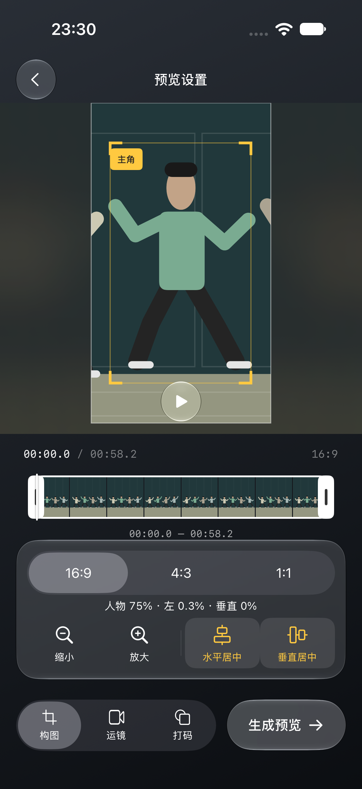
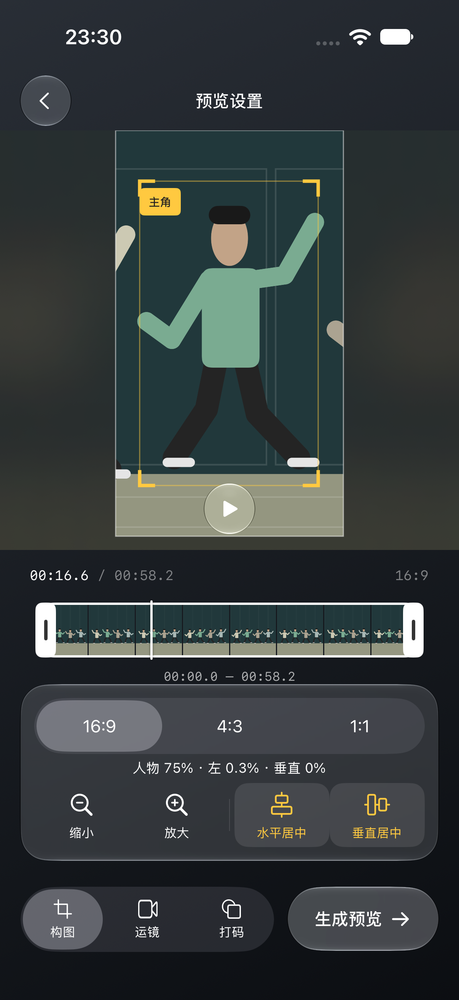
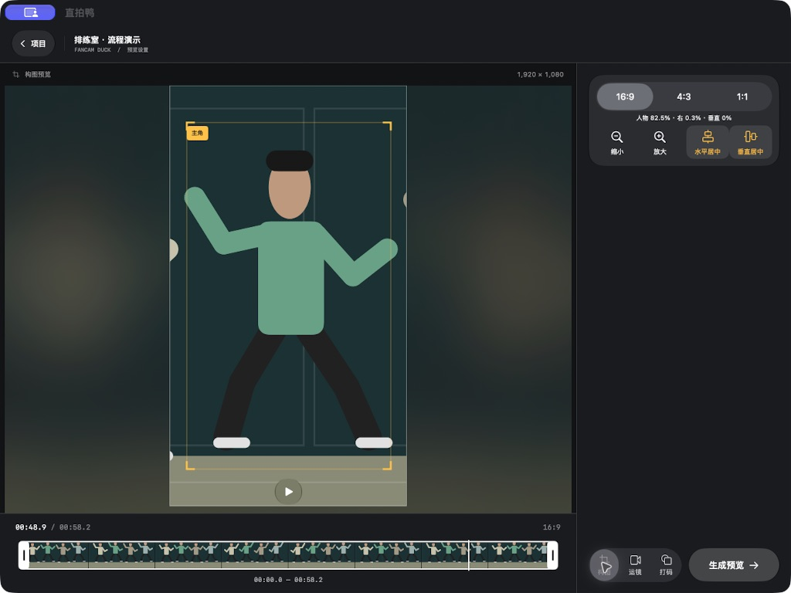
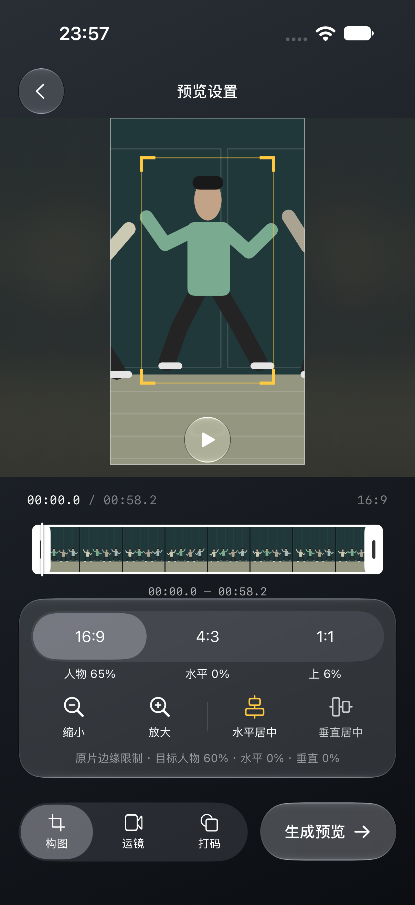
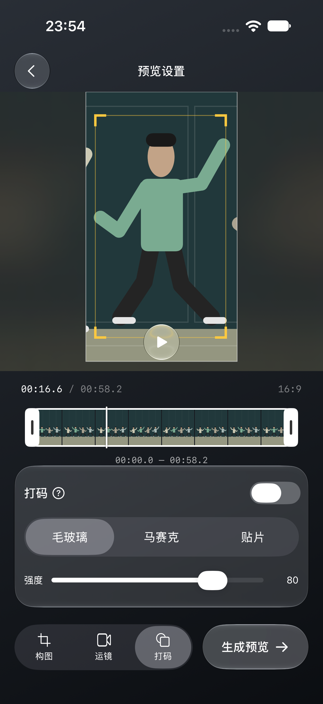

# 持续人物构图验证

日期：2026-10-21。对应[最终方案](../brainstorms/2026-10-21-composition-refactor-plan.md)。

## 实现

以下截图与首轮记录保留当时的 75% 默认值；后续界面和 60% 默认值变更见文末。

- 新项目以稳定全身高度 75%、两轴中心为默认片段目标。任意时刻拖动、缩放或使用原四按钮后重算整段；切换画幅保留目标。
- 肩／髋关键点标定人体中心与尺度，用局部中值和变化速度限制减少动作引发的缩放。可靠姿态不足时保持尺度，使用跟踪参考位置，不触发重新分析。
- 镜头同时插值位置与尺寸，预览及编码共用 CropPlan。优先填满原片，边缘修正不回写用户目标。
- 设置中显示实际占比与方向偏移、各轴居中选中状态；构图／运镜／打码均显示当前主角框。显示源帧、框和读数使用同一时刻。
- 旧设置缺少 subjectComposition 时保留原镜头算法；第一次编辑从当前实际构图迁移。新目标及可选姿态均可保存和恢复。

## 确定性及媒体回归

使用 Xcode 27.0（27A266a）、本机 iPhone 18 Pro／iOS 27 模拟器；运行结果保存在本机 /tmp，未提交构建产物。

| 结果包 | 本轮结果 |
| --- | --- |
| /tmp/fancam-subject-final-ios.xcresult | 29 项单元／媒体用例，27 通过、2 跳过；1 项 UI 通过 |
| /tmp/fancam-subject-extra-ios.xcresult | 25 项单元／媒体用例，11 通过、14 私人素材用例跳过 |
| /tmp/fancam-subject-verified-ios.xcresult | 5 项人物构图、4 项寻帧和 1 项 UI 通过 |
| /tmp/fancam-subject-final-demo-ios.xcresult | 最终代码 5 项人物构图、1 项处理状态和 1 项 UI 通过 |

这些运行有重叠，不相加为独立测试数量。覆盖持续两轴／尺度目标、非采样时刻插值、下蹲不放大、边缘不越界及恢复、旧配置解码、新目标重开、唯一缓存姿态关联和歧义拒绝、跨时刻编辑、单轴居中保留其他目标、寻帧合并与取消。

新增合成视频实际编码测试，以变焦及移动轨迹核对同一源时刻的预览帧和编码帧像素，并检查裁剪时长与尺寸；既有打码预览／编码用例亦通过。该结果证明受控素材的共享变换一致性，不是私人群舞视频跟踪效果验收。

最终 iPhone 命令（用 showdestinations 查询可用设备）：

```sh
xcodebuild -project 'Fancam Duck.xcodeproj' -scheme 'Fancam Duck' \
  -destination 'platform=iOS Simulator,name=iPhone 18 Pro' \
  -derivedDataPath /tmp/fancamduck-subject-build \
  -parallel-testing-enabled NO test \
  -only-testing:FancamDuckTests/SubjectCompositionTests \
  -only-testing:FancamDuckTests/ProcessingStateTests \
  -only-testing:FancamDuckUITests/SubjectCompositionFlowTests
```

## iPhone 界面

自动 UI 用例验证：默认 75%、两轴高亮、当前主角框、无操作说明行、页面无 ScrollView；放大 82.5%、自由拖动、独立居中、时间轴前后跳转、在新时刻修改并回看、双指缩放；主要按钮可点击且高度不少于 44pt。已实际检查截图，操作区域完整可见。





## Mac 实际窗口

Mac Catalyst 最终 arm64 未签名构建通过，日志 /tmp/fancamduck-subject-final-mac.log。另通过 Xcode 的 My Mac (Mac Catalyst) 运行实际应用，在桌面窗口完成演示分析，使用纯绘制人物检查：

- 默认 75%、两轴居中高亮、主角框和四按钮完整可见。
- 放大至 82.5% 后，水平微调更新方向百分比并取消该轴高亮；水平居中恢复高亮。
- 切换方形再返回竖向画幅，人物目标保持；跳到 19.5 秒与 48.9 秒均保持 82.5%。
- 运镜／打码工具保留当前主角框。截图为实际 Mac 应用中的模拟人物，不含私人视频。



Mac 自动 UI 曾尝试未签名、临时签名及本机开发签名运行器；运行器未正常进入 XCTest（采样停在 secinit AppSandbox 初始化），没有将其记为测试通过。桌面验收依据为上述实际窗口操作与截图。

## 仍需真实素材验收

稳定全身高度是二维姿态估计，不是三维真实身高。转身、透视、长期遮挡、低置信姿态与缺少姿态的旧缓存仍可能产生尺度／参考点偏差；合成下蹲和移动用例不能覆盖全部真实舞蹈动作。本轮未运行私人女团视频、未测真实视频位置／尺度误差分位数、性能、真机、大字体或减少动态效果。原片边缘会允许暂时偏离目标；默认 75% 不能保证所有伸展动作完整入镜。

项目原有 signing／Bundle ID 的本地工程改动保留。本轮未提交或推送代码。

## 后续界面调整

按用户最新要求，默认目标及完整重置改为 60%，已保存项目的目标不自动覆盖，旧模式 personHeight 的解码默认保持兼容。预览设置隐藏主角框文字（保留框线及辅助功能语义）；占比、水平偏移、垂直偏移均四舍五入显示整数，居中容差内显示 0%，仅图标高亮，无选中背景或文字变色。三项读数使用固定等宽列，关闭该区域内容与布局动画；底层计算精度保持不变。

整数显示和固定布局的 iPhone 回归通过，结果包 /tmp/fancam-subject-stable-readout-ios.xcresult；60% 版本的 Mac Catalyst arm64 构建通过，日志 /tmp/fancamduck-subject-60-mac.log。本次未重新验收 Mac 实际窗口或真实视频；此前 Mac 窗口截图反映调整前样式。

补充回归：/tmp/fancam-subject-controls-final-ios.xcresult 共 19 项，17 通过、2 私人素材用例跳过；包括 6 项人物构图与边缘缩放测试。/tmp/fancam-subject-panels-ios.xcresult 的 6 项人物构图及 1 项 UI 通过，覆盖打码工具切换并保存截图。首次 60% UI 断言实际显示 60% 失败，原因是绘制人物占原片高度 65%，填满优先后实际只能达到 65%；最终用例分别核对边缘实际值与保存的 60% 目标，并修正按钮放大从目标 60% 到 66%，避免从受限的实际值跳变。

三个工具共用四边 12pt 内边距与玻璃背景，构图面板高度增至 184pt，容纳边缘提示且不增加页面滚动。

最终布局：/tmp/fancam-subject-layout-final-ios.xcresult 的 1 项 UI 通过；Mac Catalyst 构建通过，日志 /tmp/fancamduck-subject-layout-final-mac.log。实际检查 iPhone 截图：边缘提示及面板圆角完整可见，主要控件可点击、页面不滚动。





读数对齐补充：三列固定宽度内分别居中，保留无动画刷新；/tmp/fancam-subject-centered-readout-ios.xcresult 的 1 项 UI 通过，并核对更新后的 60% 目标截图。
