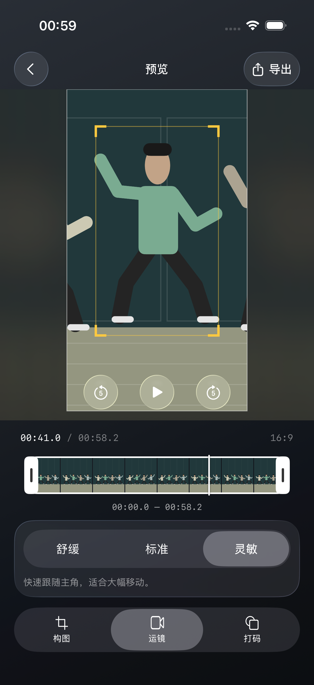

# 实时预览工作台（2026-10-22）

## 交互设计与实现

分析完成后留在同一页面，标题为「预览」。底部三个原生工具占满宽度，移除生成预览、重新生成及预览成片按钮。播放直接使用当前构图、运镜及打码的合成，不先生成 MP4。

播放按钮仍位于视频区域底部居中，左右各增加前后 5 秒，热区至少 44pt。正在播放时调参会暂停旧合成、显示更新状态，并在最新配置准备完成后恢复播放。准备中点播放会记录意图，再点等待按钮可取消。时间轴拖动暂停，松手精确定位；拖动前播放则恢复，原来暂停则保持暂停。跳转限制在所选起终点内，终点后再次播放从起点开始。Mac 保留空格播放及 Cmd+E 打开导出。

右上角「导出」进入独立画质／导出页，点击导出入口本身不编码文件。入口等待最新预览准备完毕，并验证项目、配置、任务 ID；临时打码轨迹必须完整覆盖当前范围才交给导出。回到预览保留时间位置。后台、返回首页、切换项目及取消操作清除播放意图，晚到任务不能恢复旧播放或打开旧导出页。

界面沿用玻璃、原生分段及现有面板动画；手机不滚动。iPhone、宽屏与 Mac 共用工具／导出交互，桌面仍为分栏布局。

## 界面

以下为自动化 UI 测试中的绘制模拟人物，不含真实人物素材。

## 验证范围

- `LivePreviewTests`：设置更新后恢复最新播放、取消等待、前后跳转边界、打开导出不编码、返回保留位置、退出不恢复播放。
- `ContinuousSettingsTests`：等待预览时退出不打开旧导出，快速设置切换及取消／晚到结果保护。
- `MediaIntegrationTests`：程序生成视频可在编码前播放完整打码预览；播放中修改强度后使用新配方；导出沿用同一完整打码计划，打开选项时没有输出文件。
- iPhone UI：新预览直接播放、切换运镜、时间轴拖动恢复播放、前后跳转及导出；原生比例、打码范围／样式／贴片、起终点与构图布局。
- Mac Catalyst 仅构建验证，本轮未做 Mac 窗口点击验收；模拟视频不代表真实 4K 视频吞吐、真机帧率或 ANE/GPU 性能测量。

最终结果：Xcode 27.1，iPhone 17 Pro／iOS 26.3.1。完整单元测试 199 项：146 通过、53 因素材或验证开关未配置跳过、0 失败。实时预览新流程、原生比例／打码设置面板、人物构图三个 UI 用例均通过（分次运行）；更新旧 UI 测试对已移除生成按钮和旧默认强度的断言。最终取消保护与媒体集成定向回归通过，Mac Catalyst Debug 构建及 diff 检查通过。
