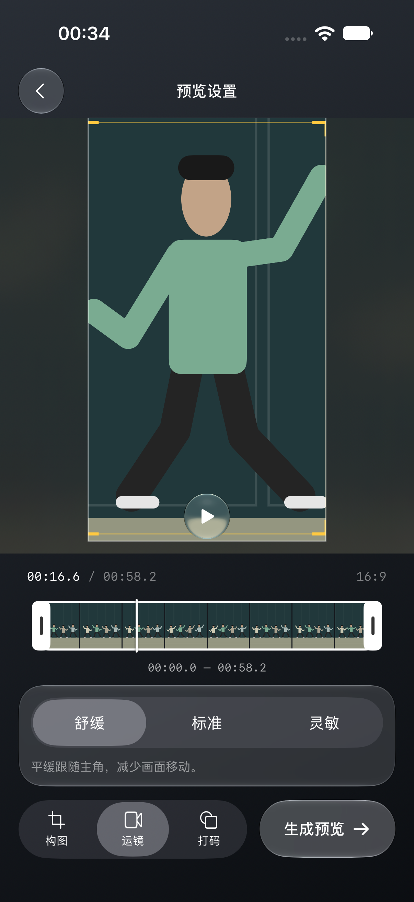
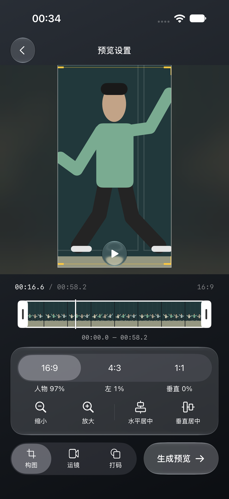
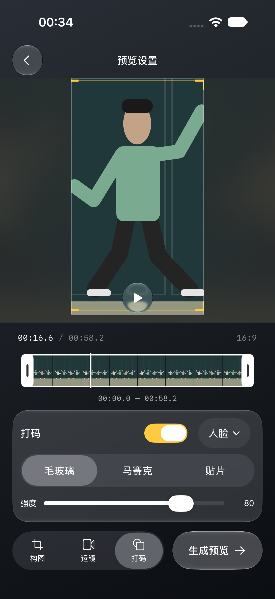

# 设置卡片间距与切换验证

日期：2026-10-22。

## 改动

此前固定高度比卡片内容高，造成构图底部空白。仅改为底部对齐又把空白移到了上方，较矮的卡片没有释放视频与时间轴区域。本轮改为三个工具共用实际内容高度测量与高度上限；当前工具测量结果沿用同一 0.24 秒 smooth 曲线更新，退场工具回调不覆盖新工具。

统一四边 12pt 内容内边距、玻璃背景及 6pt 淡入淡出位移。打码原生开关／滑块行保留 44pt 交互区域，各收回上下 6pt 原生空白；三个工具到下方操作栏均为 12pt，到上方时间轴的间距以运镜为基准保持一致。移除构图内部提示及其预留高度。打码原生开关开启使用主题黄色。

按用户授权恢复 RedactionCompositor 的 sourcePixelBufferAttributes 属性名；该文件已回到提交版本，没有遗留改动。

## 验证结果

Xcode 27.0（27A266a），iPhone 18 Pro／iOS 27 模拟器：

- SubjectCompositionFlowTests 1 项通过，结果包 /tmp/fancam-panels-unified-ios.xcresult。
- 逐一切换运镜、构图、打码：卡片到底部生成按钮间距断言为 12pt，容差 1pt；卡片与时间轴的顶部间距与运镜比较，容差 1pt，全部通过。
- 检查默认与调整构图、拖动／双指缩放、跨时刻修改、独立居中、主角框、整数读数、无提示、页面无滚动和主要按钮热区。
- 开关点击后状态为 1；实际查看截图确认开启为主题黄色，打码内容完整，三卡片无固定空白占位。
- Mac Catalyst arm64 构建通过，日志 /tmp/fancam-panels-unified-mac.log；本轮没有运行 Mac 窗口、真机、大字体及真实视频观感测试。
- git diff --check 通过。

验证过程曾因无关本地属性改名阻塞；恢复后，新增卡片度量标识被外层覆盖、开关用例点击标签区域和弱捏合断言分别调整为复用实际卡片标识、点击原生开关右侧和明确的缩放手势，最终上述回归通过。

## 实际模拟器截图

仅使用绘制的模拟人物。

顶部留白补充：按用户要求在三个手机面板与时间轴之间统一增加 12pt 外边距，底部仍为 12pt。/tmp/fancam-panels-top-inset-ios.xcresult 的 1 项 UI 回归通过；已更新并检查截图。

顶部留白最终调整：按用户要求由 12pt 缩为 8pt，底部仍为 12pt；本次仅完成差异检查，未重复运行 UI 回归。

提交前最终值：顶部外边距调整为 10pt，底部 12pt，内部共用 12pt。10pt 的常量改动完成差异检查，未重复启动模拟器；此前 12pt 版本的布局和交互 UI 回归通过。

最终界面回归：/tmp/fancam-settings-final-ui.xcresult 的 1 项 UI 通过（TEST SUCCEEDED）。截图已更新为顶部 10pt、无问号及说明浮层的最终样式，开启打码的菜单行保持完整高度；三卡片上下间距断言通过。
